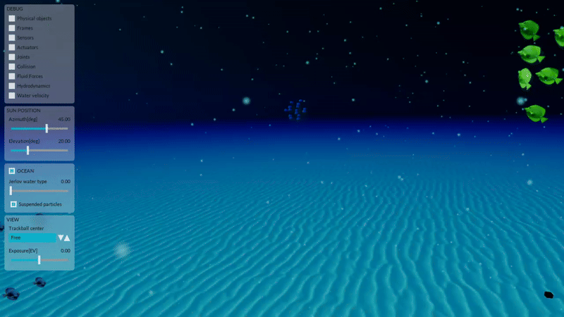

# STONEFISH_BOIDS

Boids algorithm C++ implementation to simulate school of fish behavior in [Stonefish](https://github.com/patrykcieslak/stonefish) simulator for underwater robotics.

  

  

## Installation
This is a catkin ROS1 `noetic` package, so to install it a `catkin build stonefish_boids` in a catkin workspace is enough.
### Dependencies
The required dependencies are the following:
- Stonefish simulator:
  - Base simulator for fish (boids) graphics rendering.
- stonefish_ros:
  - As ROS based AUV is intended to be used with the boids in simulation.
- OMPL ros package:
  - Each boid school follows a path connection two random points, the path is generated using the RRT implementation of OMPL for flexibility.
  Installed with `sudo apt install ros-noetic-ompl`

## Execution
For execution simply run the base launch file. Any modifications as scenario file or else is in the launch file.
`roslaunch stonefish_boids stonefish_boids.launch`

## Stonefish scenario.
The Boids are spawned and controlled at runtime using the Stonefish C++ API, so any *.scn* file in the `scenarios` folder can be loaded in the launch file as it is usually done.

